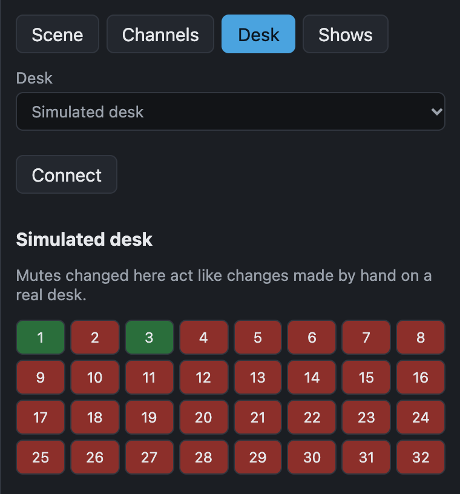

# Connect a desk

cuemute talks to the desk over the network. Connect the desk and the show machine to the same network switch, or straight to each other with a network cable.

The desk settings are saved in the show. When you open a show, cuemute connects to the desk that show names.

## Connect a Qu

1. Connect the Qu's network port to the same network as the show machine.
2. On the Qu, find its IP address on the network page of the **Setup** screen.
3. In cuemute, switch to **Edit** mode.
4. Open the **Desk** tab.
5. Choose **Allen & Heath Qu** and enter the desk's IP address.
6. Select **Connect**.

{ width="380" }

The status at the top changes to **Reading desk…** and then to **Desk connected**. cuemute reads every input's mute state, and finds the desk's MIDI channel by itself.

The Qu accepts only one MIDI connection at a time. Close A&H MIDI Control, and any Companion module that talks to the Qu directly, before you connect cuemute.

With a Qu, **Import names from desk** on the **Channels** tab copies the desk's channel names into the show.

## Connect an SQ

1. On the SQ, open **Utility > General > MIDI** and note the MIDI channel.
2. Connect the SQ's network port to the same network as the show machine.
3. In cuemute, switch to **Edit** mode.
4. Open the **Desk** tab.
5. Choose **Allen & Heath SQ**.
6. Enter the desk's IP address, and the MIDI channel from step 1.
7. Select **Connect**.

cuemute asks the SQ for each input's mute, which takes under a second. If the desk doesn't answer, the MIDI channel in cuemute doesn't match the desk, and cuemute says so next to the status.

The SQ can't send channel names over MIDI, so type the names on the **Channels** tab.

## Program without a desk

Choose **Simulated desk** on the **Desk** tab. It acts like a 32-input desk. Under it, a grid of buttons stands in for the desk's mute keys: a change there acts like a change made by hand on a real desk. Use it to try **Record**, or to see how the grid shows changes made on the desk.

When you get to the venue, open the **Desk** tab, choose the real desk, and select **Connect**. The scenes don't change.

## If the desk disconnects

The status turns red, and GO is disabled until the desk comes back. cuemute tries to reconnect by itself.

When it reconnects, cuemute reads the desk again and sends nothing. Check the grid before the next GO: mutes changed on the desk while it was disconnected show there.

If the status stays at **Connecting to desk…**:

- Check that the IP address on the **Desk** tab matches the desk.
- Check that the show machine has an address on the same network as the desk, for example `192.168.1.x` for a desk at `192.168.1.70`.
- With a Qu, check that nothing else is using its MIDI connection.
