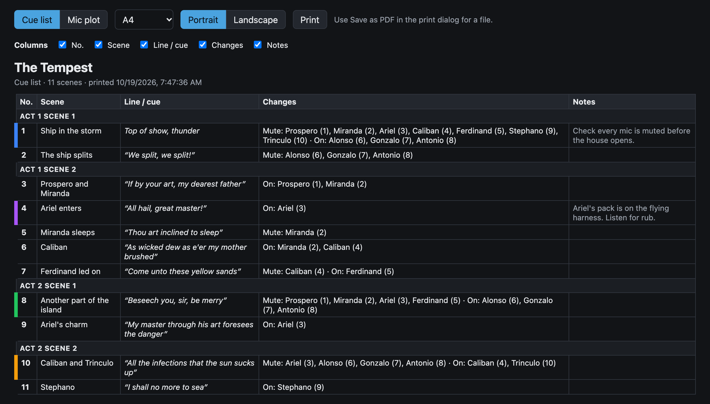
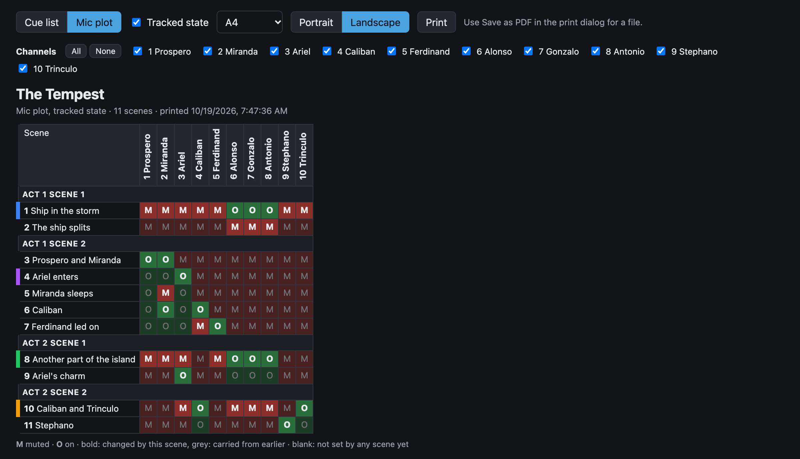

# Print a cue sheet

The cue sheet is a paper copy of the show for the book or the A1. Select **Cue sheet** at the top of the screen. It opens in a new browser tab, and follows the show live, so edits appear on it straight away.

There are two layouts.

## Cue list

One row per scene, under its group, with the cue line, what the scene mutes and opens, and its notes.

To choose the columns, use the **Columns** checkboxes.

## Mic plot

Scenes down the side and channels across the top. Each cell is **M** (muted) or **O** (on).

By default the plot shows only what each scene changes. Turn on **Tracked state** to show every channel's state after each scene: the scene's own changes are bold, and states carried from earlier are grey. A channel is blank until the first scene that sets it.

To leave channels out, for example a spare mic, untick them under **Channels**. Hiding a channel only removes its column: tracked state still counts every scene. New channels show until you untick them.

## Print or save as PDF

1. Choose the paper size: **A4** or **US Letter**.
2. Choose **Portrait** or **Landscape**. The cue list starts in portrait and the mic plot in landscape.
3. Select **Print**.
4. To get a file, choose **Save as PDF** in the print dialog.

The print dialog follows the paper and orientation set on the page, so set them on the page, not in the dialog.

Your choices are kept in the page address. Bookmark the page to get the same sheet again.
