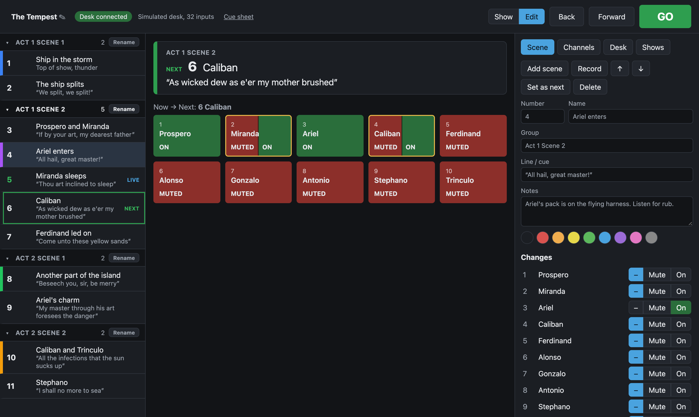
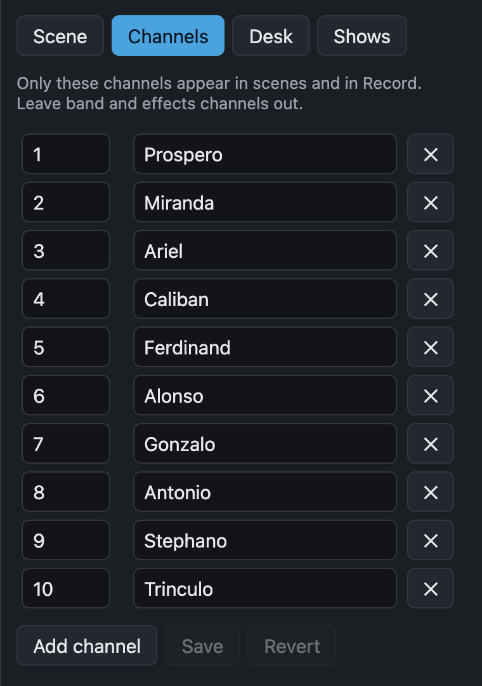
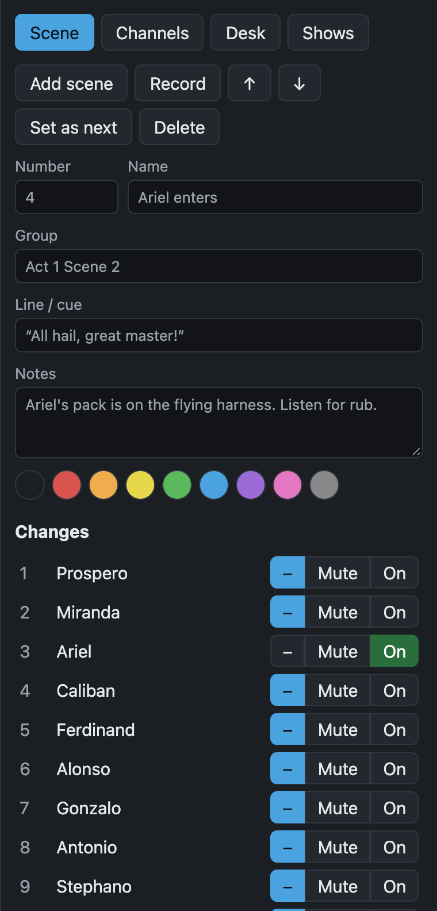

# Program a show

Programming happens in **Edit** mode. Select **Edit** at the top right. Every change saves straight away, so there is no Save button.

The screen has three columns: the scene list on the left, the next scene and the channel grid in the middle, and the editor on the right.

## Name the show

Select the show name at the top left, type a new name, and confirm.

## List the channels

cuemute only works with the channels in the show's channel list. List the radio mics, and leave band and effects channels out: cuemute never touches a channel that isn't in a scene.

1. Open the **Channels** tab.
2. Select **Add channel** for each mic.
3. Enter the desk channel number and a name, for example the character.
4. Select **Save**.

{ width="380" }

With a Qu, **Import names from desk** fills in the names the desk has for each listed channel.

You can add a channel at any time. Scenes you already have don't change, because a scene only lists what it changes.

## Add scenes

There are two ways to make a scene.

**Add scene** makes an empty scene after the selected scene. Then set what it does:

1. Select the scene in the list.
2. In the editor, fill in **Number**, **Name** and **Line / cue**.
3. Under **Changes**, set each channel to **–** (leave alone), **Mute** or **On**.

{ width="380" }

**Record** makes a scene from the desk. Set the mutes on the desk by hand, then select **Record**. The new scene holds every listed channel that changed since the last GO, and goes after the live scene. Record is the fast way to program in a tech rehearsal: fire a scene, fix the mutes on the desk, and record the next one.

## Fill in the scene details

| Field | What it is for |
|---|---|
| **Number** | The cue number the operator calls, such as `12` or `12A`. It is a label only: the order of the list sets the order of the show. cuemute marks numbers that appear twice. |
| **Name** | A short name, shown in the list and on the next-scene panel. |
| **Group** | Groups neighbouring scenes under one heading, for example `Act 1 Scene 2`. See [Group scenes](#group-scenes). |
| **Line / cue** | The line or moment that the scene goes on, shown large in the next-scene panel. |
| **Notes** | Anything the operator needs, such as a mic to check. |
| Colour | A stripe down the side of the scene, to find it at a glance. |

## Change the order

Select a scene, then use **↑** and **↓** to move it. To delete a scene, select it and select **Delete**.

## Group scenes

Give neighbouring scenes the same **Group** to show them under one heading, for example all the scenes in one script scene. A new or recorded scene takes the group of the scene before it, so you only type a group name once.

- Select a group heading to collapse it. The group that holds the live, next or selected scene always stays open.
- **Rename** on a group heading renames the group on every scene that has it.
- Each screen remembers its own collapsed groups.

Groups only change how the list looks. The show still runs top to bottom.

## Try it before the show

Use the [simulated desk](connect.md#program-without-a-desk) to step through the show without hardware, or [print a cue sheet](cue-sheet.md) to check the scenes on paper.
