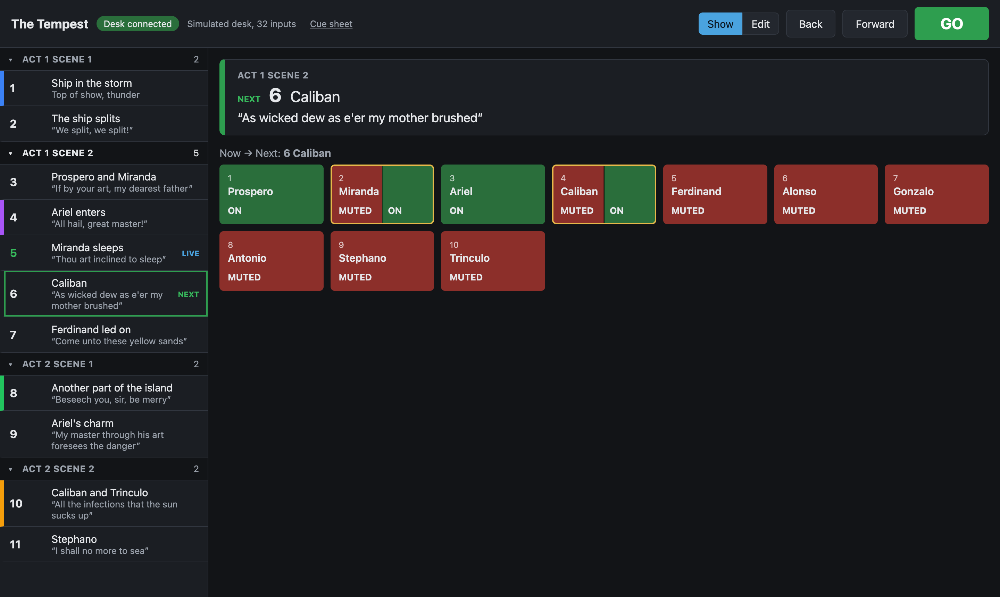
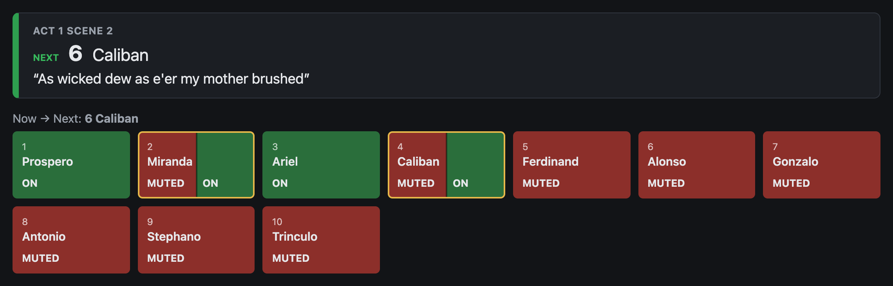
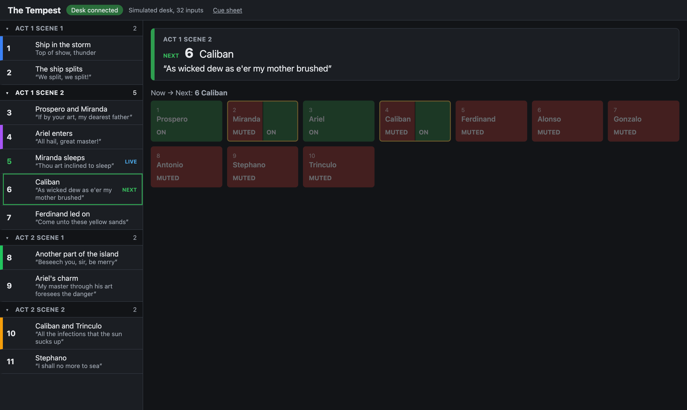

# Run a show

Switch to **Show** mode before the performance. Show mode hides the editing tools on every screen, so nothing in the show changes by accident. GO and the other controls below work in both modes.

## Run the show with GO

Press **GO**, or the Space bar, to fire the next scene. cuemute sends that scene's mutes to the desk, marks it **LIVE**, and moves **NEXT** on to the scene after it.

| To | Do this |
|---|---|
| Fire the next scene | **GO**, or Space |
| Move NEXT back one scene | **Back**, or ← |
| Skip a scene | **Forward**, or →. Forward stops at the last scene. |
| Choose the next scene | Click it in the list. In Edit mode, select it and then **Set as next**. |
| Fire any scene now | Double-click it |
| Mute or unmute one channel | Click its tile on the grid |

Back, Forward and choosing the next scene send nothing to the desk. They only change which scene GO fires. After GO, cuemute carries on from the scene it fired.

The keys do nothing while you are typing in a field.

## Read the next scene

The panel at the top shows the scene GO will fire: its group, number, name and cue line, and its notes if it has any. Under it, **Now → Next** names the same scene.

The grid shows every channel in the show:

- **Green, ON**: the channel is open on the desk.
- **Red, MUTED**: the channel is muted on the desk.
- **Split tile with a yellow border**: the next scene changes this channel. The left half is the state now, and the right half is the state after GO. In the picture, GO opens Miranda and Caliban.
- **Dashed border, "already"**: the next scene sets this channel to the state it is already in. Someone has probably changed it on the desk by hand.

The grid follows the desk, so a mute changed on the desk shows straight away.

## Fire a scene out of order

To jump to a scene, double-click it. cuemute fires only that scene's own changes. It doesn't apply the scenes in between, so check the grid after a jump: channels that the skipped scenes would have changed are as they were.

To get to a scene without firing anything, click it in Show mode to make it next, then press GO when you are ready.

## Put a screen backstage

To show the cue list on a screen that can't run the show, open the address with `?view` on the end, for example `http://192.168.1.10:4000/?view`. It shows the live and next scenes and the grid, with no GO and no editing.

## If something goes wrong

- **The desk disconnects**: the status turns red and GO is disabled. cuemute reconnects by itself and reads the desk again without sending anything. Check the grid before the next GO.
- **cuemute closes or the show machine restarts**: start cuemute again. It reopens the same show with nothing live and the first scene next. Click the scene you were on to make it next, or double-click it to fire it.
- **The browser loses cuemute**: the status says **Server unreachable**. The browser reconnects by itself when cuemute is back.
