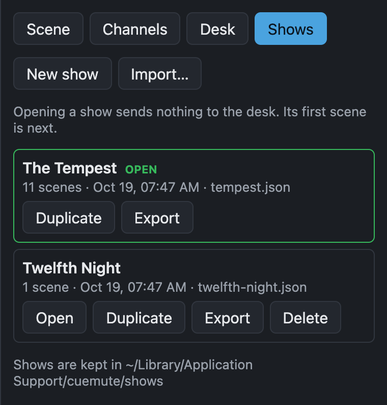

# Manage shows

cuemute keeps every show in one folder, the show library. One show is open at a time, and cuemute saves every change to it straight away. When cuemute starts, it reopens the show you had open last.

To work with shows, switch to **Edit** mode and open the **Shows** tab.

{ width="380" }

| To | Do this |
|---|---|
| Start a new show | Select **New show** and type a name. The new show uses the same desk settings as the open show. |
| Switch to another show | Select **Open** on that show. |
| Save a copy under a new name | Select **Duplicate** on a show. The copy opens. |
| Copy a show to another machine | Select **Export** to download the show file. On the other machine, select **Import…** and pick the file. The imported show opens. |
| Delete a show | Open another show first, then select **Delete** and confirm. |

## Opening a show

Opening a show sends nothing to the desk. No scene is live and the first scene is next, so the desk changes only when you press GO.

If the show names a different desk, cuemute connects to that desk. Every screen, and Companion, switch to the opened show.

You can only open a show in Edit mode, so nobody can switch shows from an iPad during a performance.

## Back up a show

Each show is one file with the extension `.json`, in the `shows` folder. To back up a show, use **Export**, or copy its file.

Each time cuemute saves a show, it keeps the version before as a `.bak` file next to it, for example `tempest.json.bak`. If a change goes wrong, close cuemute, delete the show's file, rename the `.bak` file to the show's file name, and start cuemute again.

A show's file is named after the show when you make it, for example `the-tempest.json`. Renaming the show later doesn't rename the file.

## Keep shows in another folder

To keep the show library somewhere else, for example in Dropbox so it is backed up, set `shows` in the settings file. See [Settings](settings.md).
